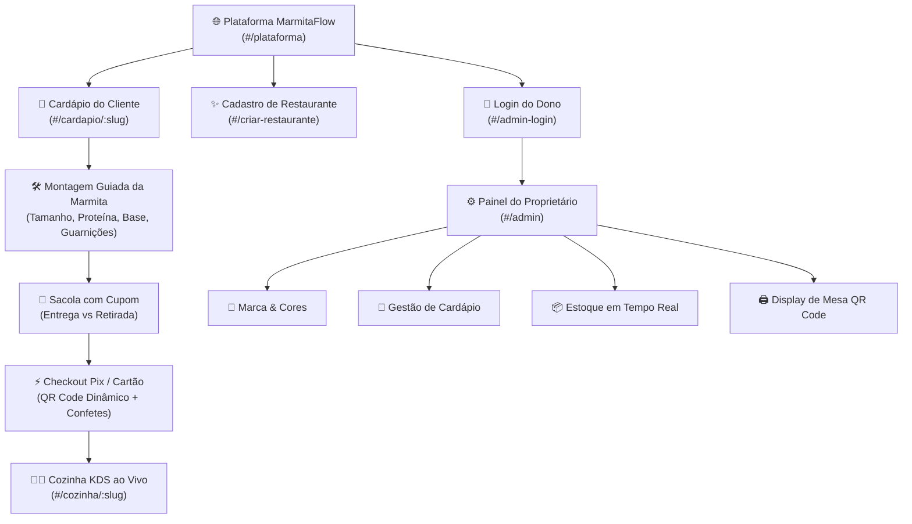

# 🍱 MarmitaFlow - O Cardápio Digital Inteligente & Plataforma SaaS Multi-Tenant

> **"O cardápio digital que conecta pedido, estoque, pagamento e cozinha em tempo real."**  
> *Projeto Acadêmico Integrador • Experiência de Delivery Real • Zero Rasuras • 100% Personalizável*

---

## 👥 Integrantes do Projeto
- **Vinícius Spejo da Silva**
- **Rafael Miquelin**
- **Matheus Nery**
- **João Vitor dos Santos**

---

## 📌 1. Visão Geral e Motivação

O setor gastronômico de marmitarias e restaurantes populares enfrenta desafios diários com o uso de materiais analógicos:
1. **Cardápios Impressos Rasurados:** A oscilação diária no preço de insumos e no estoque faz com que donos risquem e alterem preços à caneta nos menus físicos, gerando poluição visual e má impressão.
2. **Erros no Atendimento:** Pedidos recebidos via áudios de WhatsApp geram anotações truncadas e esquecimento de acompanhamentos.
3. **Comandas Extraviadas na Cozinha:** Papéis molhados ou perdidos atrasam a produção e confundem a equipe do fogão.
4. **Taxas Abusivas de Marketplaces:** Grandes aplicativos de delivery chegam a cobrar de 12% a 27% sobre cada pedido.

### 💡 A Solução MarmitaFlow
O **MarmitaFlow** nasceu para revolucionar essa operação:
- **Plataforma SaaS Multi-Tenant:** Qualquer empreendedor pode abrir seu restaurante independente, definir sua identidade visual (nome, cores, logo, taxa de entrega) e publicar seu cardápio em minutos.
- **Restaurante "Marmita Flow" Oficial:** Opera de forma independente dentro da plataforma como modelo de boas práticas.
- **Pix Direto ao Dono:** Pagamento instantâneo via QR Code e Copia-e-Cola direto na chave Pix do proprietário, sem intermediários.
- **Cozinha Inteligente (KDS):** Comanda digital em Kanban (*Novos ➔ Em Preparo ➔ Pronto ➔ Entregue*) com checklist interativo para conferência de itens e aviso sonoro na chegada de pedidos.
- **Controle de Estoque ao Vivo:** Botão de pausa com 1 clique para itens esgotados, evitando cancelamentos de pedidos.

---

## 🚀 2. Arquitetura e Fluxo do Sistema



---

## 🍽️ 3. Principais Módulos do Sistema

### 🍱 Cardápio Online do Cliente (`#/cardapio/:slug`)
- **Storefront Completo:** Banner de capa apetitoso, mascote/logo, nota de avaliações, tempo estimado e status (*Aberto Agora*).
- **Busca em Tempo Real & Filtros:** Busca instantânea por pratos e categorias (*Tradicionais*, *Fit & Equilíbrio*, *Gourmet*, *Personalizável*, *Bebidas*, *Sobremesas*).
- **Montagem Guiada da Marmita:**
  1. *Tamanho:* P (400g), M (600g), G (800g);
  2. *Proteína Principal:* Frango grelhado, carne de panela, salmão, bisteca suína, etc.;
  3. *Base:* Arroz branco soltinho, integral com sementes, arroz com brócolis;
  4. *Feijão:* Feijão preto temperado, carioca cremoso ou sem feijão;
  5. *Guarnições:* Até 2 opções inclusas (farofa, legumes, couve no alho, batata rústica, purê);
  6. *Adicionais:* Ovo frito gema mole, torresmo pururuca, vinagrete artesanal;
  7. *Observações para a cozinha.*
- **Sacola de Pedidos:** Alternador entre Entrega e Retirada no balcão, cupom promocional (`MARMITA10` = 10% OFF).
- **Checkout com Pix Instantâneo:** Geração de QR Code via biblioteca `qrcode`, código copia-e-cola, celebração com chuva de confetes (`canvas-confetti`) e som de sucesso.
- **Rastreador de Pedido em Tempo Real:** Acompanhamento ao vivo do preparo da refeição.
- **Alternador Desktop / Celular (App):** Permite simular a experiência mobile-first com moldura de celular e notch de 5G.

### ⚙️ Painel Administrativo Protegido do Dono (`#/admin`)
- **Autenticação Segura (Auth Guard):** Acesso exclusivo para o proprietário logado.
- **Dashboard de Métricas:** Faturamento total, pedidos recebidos, quantidade de pratos e status da loja.
- **Minha Marca & Configurações:** Customização de nome, slogan, paleta de cores primárias, chave Pix, WhatsApp e taxa de entrega.
- **Gerenciador de Cardápio:** CRUD completo de pratos e categorias.
- **Estoque em Tempo Real:** Botão com 1 clique para marcar pratos como esgotados na cozinha.
- **Display de Mesa para Salão:** Geração de display com QR Code imprimível para fixar nas mesas do restaurante.

### 👨‍🍳 Cozinha KDS (`#/cozinha/:slug`)
- Tela de expedição industrial em colunas Kanban: *Recebidos ➔ Em Preparo ➔ Prontos ➔ Entregues*.
- Checklist interativo item a item para evitar erros de expedição.
- Sinal sonoro via Web Audio API na chegada de novos pedidos.

### 🎓 Sobre o Projeto (`#/sobre`)
- Apresentação acadêmica, desafios solucionados e créditos da equipe desenvolvedora.

---

## 🔑 4. Contas de Demonstração (Acesso Rápido)

Para testar o acesso administrativo imediatamente na tela `#/admin-login`:

| Restaurante | E-mail de Acesso | Senha | Perfil |
| :--- | :--- | :--- | :--- |
| **Marmita Flow (Oficial)** | `admin@marmitaflow.com` | `123456` | Administrador Principal |
| **Cantina da Nona** | `nona@cantina.com` | `123456` | Restaurante Parceiro |

---

## 💻 5. Tecnologias Utilizadas

- **Core:** JavaScript Moderno (ES6+), HTML5 Semântico.
- **Estilização:** Vanilla CSS Moderno Modular com Design Tokens (HSL, Glassmorphism, Micro-animações).
- **Build & Dev Server:** [Vite](https://vitejs.dev/) com Hot Module Replacement (HMR).
- **Tipografia:** Google Fonts (*Outfit* e *Plus Jakarta Sans*).
- **Geração de QR Code:** `qrcode` (renderização dinâmica em Canvas).
- **Micro-interações:** `canvas-confetti` (celebração de pagamento).
- **Efeitos Sonoros:** Web Audio API nativa (chime de cozinha e confirmação de Pix sem arquivos pesados de áudio).
- **Persistência de Estado:** Store Multi-Tenant Reativa com LocalStorage resiliente.
- **CI/CD & Deploy:** GitHub Actions + GitHub Pages.

---

## 📁 6. Estrutura do Repositório

```text
projeto-marmita-flow/
├── .github/
│   └── workflows/
│       └── deploy.yml          # Pipeline de Deploy Automático no GitHub Pages
├── public/
│   └── assets/                 # Imagens em alta resolução dos pratos e marcas
├── src/
│   ├── views/
│   │   ├── PlatformHome.js     # Portal Inicial SaaS Multi-Tenant
│   │   ├── RestaurantMenu.js   # Cardápio Público do Restaurante (Mobile/Desktop)
│   │   ├── AdminDashboard.js   # Painel Administrativo Protegido do Dono
│   │   ├── AdminLogin.js       # Tela de Login do Dono com Atalhos Demo
│   │   ├── CreateRestaurant.js # Cadastro de Novo Restaurante Independente
│   │   ├── KitchenView.js      # Cozinha Inteligente (KDS)
│   │   └── AboutView.js        # Página Institucional e Equipe Acadêmica
│   ├── audio.js                # Síntese de áudio via Web Audio API
│   ├── main.js                 # Roteador Hash SPA (#/rota) e Casca Global
│   ├── store.js                # State Store Multi-Tenant com Persistência
│   └── style.css               # Design System completo e responsivo
├── index.html                  # Ponto de entrada HTML5
├── vite.config.js              # Configuração Vite com caminhos relativos
├── package.json                # Dependências e scripts npm
└── README.md                   # Documentação completa do projeto
```

---

## 🛠️ 7. Como Executar Localmente

### Pré-requisitos
- Node.js (versão 18 ou superior)
- Gerenciador de pacotes `npm`

### Passo a Passo
```bash
# 1. Clone o repositório
git clone https://github.com/rafaelccbr/Projeto-integrador1.git

# 2. Acesse a pasta do projeto
cd Projeto-integrador1

# 3. Instale as dependências
npm install

# 4. Inicie o servidor de desenvolvimento
npm run dev
```

Abra seu navegador em: **[http://localhost:5173/](http://localhost:5173/)**

Para gerar os arquivos estáticos de produção:
```bash
npm run build
```

---

## 🌐 8. Como Hospedar no GitHub Pages

O projeto já está com o pipeline de **GitHub Actions** configurado em [`.github/workflows/deploy.yml`](.github/workflows/deploy.yml).

### Passos no GitHub:
1. Acesse o seu repositório no GitHub: `https://github.com/rafaelccbr/Projeto-integrador1`
2. Vá em **Settings** (Configurações) ➔ **Pages** (no menu lateral esquerdo).
3. Na seção **Build and deployment**:
   - Em **Source**, selecione **GitHub Actions**.
4. Faça qualquer push na branch `main` (ou clique na aba **Actions** e execute o workflow manualmente).
5. O site será compilado e publicado automaticamente com URL no formato:
   `https://rafaelccbr.github.io/Projeto-integrador1/`

---

## 📄 Licença
Este projeto foi desenvolvido para fins acadêmicos e integradores na faculdade. Todos os direitos reservados à equipe de desenvolvimento.
